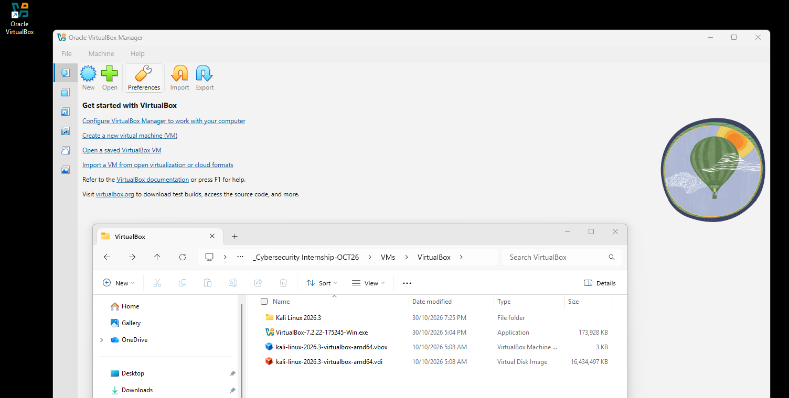
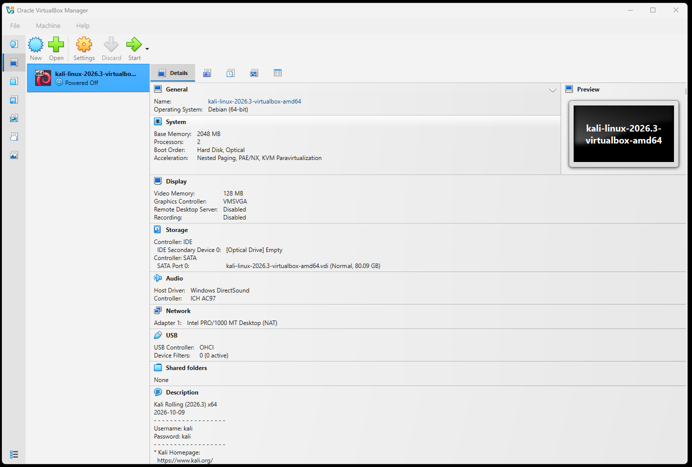
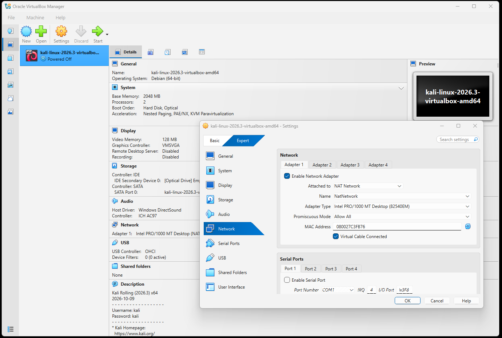
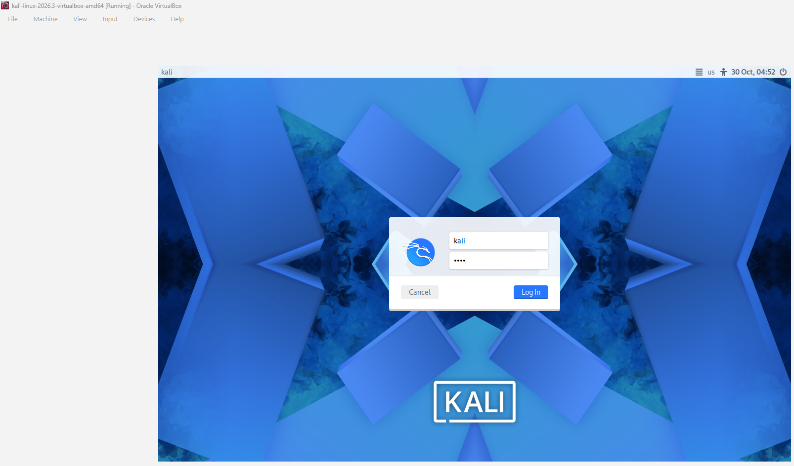
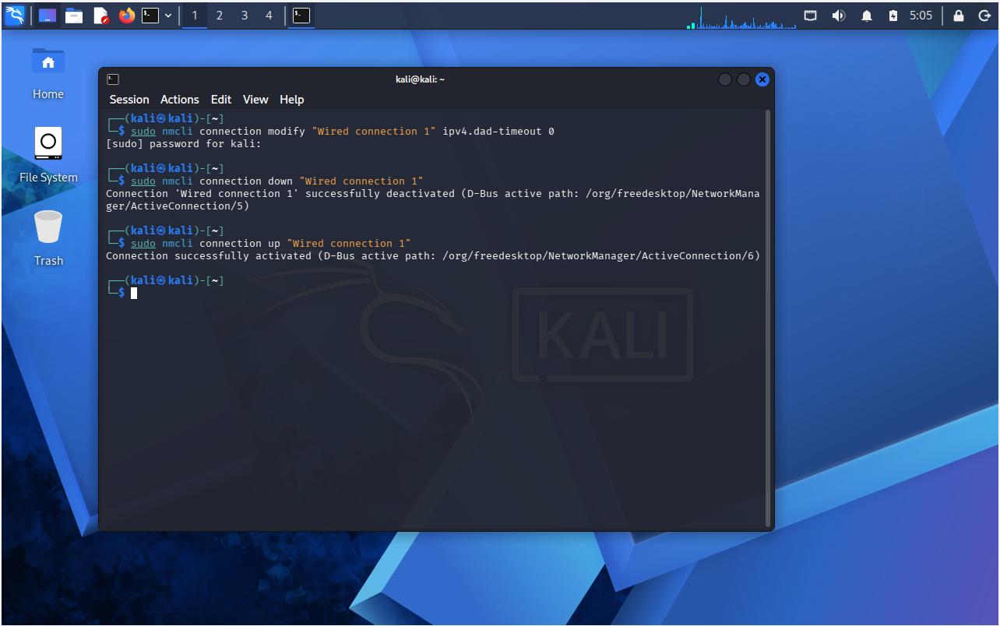
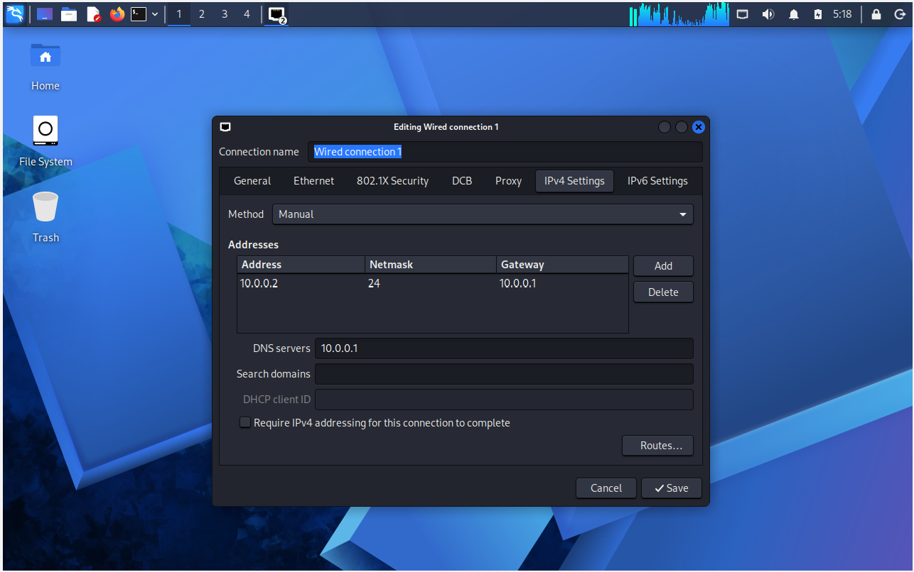
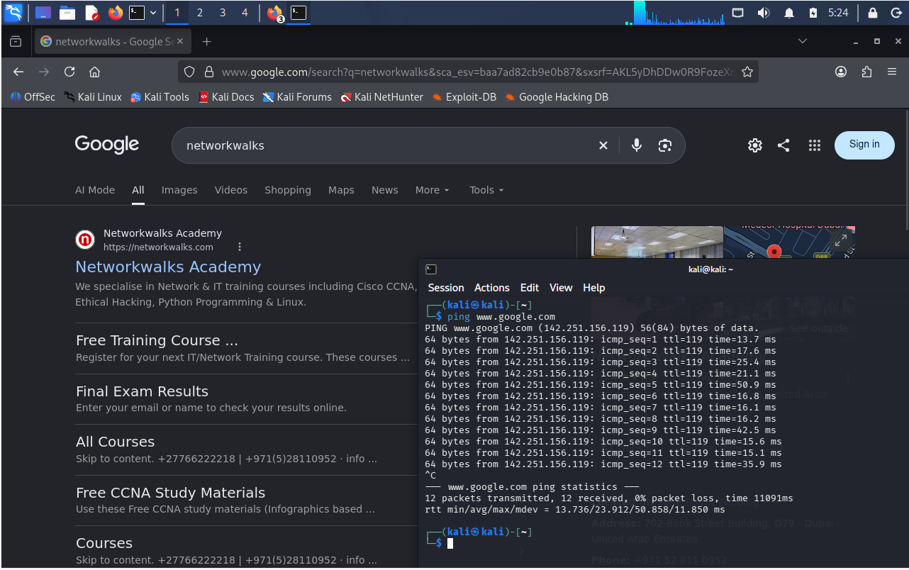
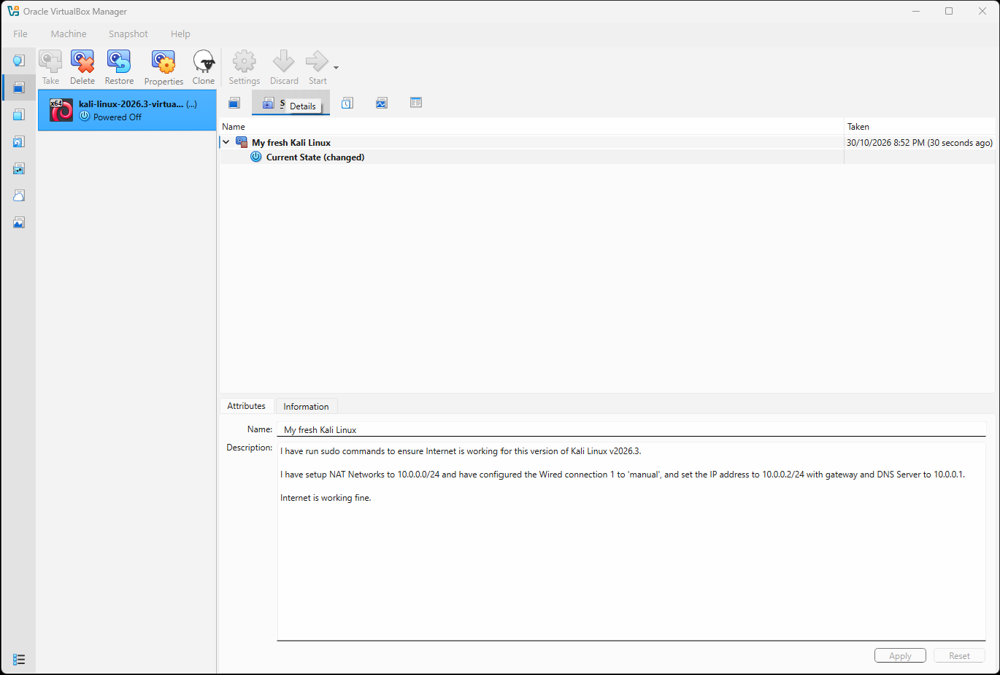

# 🔐 Week 1 – Cybersecurity Lab Environment Setup

## 📌 Lab Overview

**Week:** 01  
**Lab Title:** Setting Up a Cybersecurity Testing Environment  
**Platform:** Oracle VirtualBox  
**Operating System:** Kali Linux 2026.3  
**Network Configuration:** NAT Network (10.0.0.0/24)

### 🎯 Objective

The objective of this lab was to establish a dedicated cybersecurity testing environment on my laptop using Oracle VirtualBox and Kali Linux.

This involved installing and configuring VirtualBox as the virtualisation platform, deploying Kali Linux as the primary penetration testing operating system, configuring a dedicated NAT Network, and verifying internet connectivity.

The goal was to establish a stable virtual lab environment that could be used for future cybersecurity exercises, practical testing and hands-on learning.

---

## 🛠️ 1. Tools and Technologies

The following tools and resources were used:

| Tool / Technology | Version / Configuration | Purpose |
|---|---|---|
| Oracle VirtualBox | 7.2.22 | Virtualisation platform |
| Kali Linux | 2026.3 | Penetration testing operating system |
| NAT Network | 10.0.0.0/24 | Virtual network configuration |
| IPv4 Address | 10.0.0.2/24 | Kali Linux static IP |
| Default Gateway | 10.0.0.1 | Network gateway |
| DNS Server | 10.0.0.1 | DNS resolution |

### Official Downloads

- [Oracle VirtualBox](https://www.virtualbox.org/)
- [Kali Linux](https://www.kali.org/get-kali/)

---

## ⚙️ 2. Lab Implementation

### Step 1 – Download Required Software

Downloaded the required installation files from their respective official websites:

1. Oracle VirtualBox version 7.2.22.
2. Kali Linux 2026.3 virtual machine setup files.

---

### Step 2 – Install Oracle VirtualBox

Extracted the downloaded VirtualBox installation package and completed the installation process.

VirtualBox was configured as the base virtualisation platform for hosting and managing the Kali Linux virtual machine.

---

### Step 3 – Configure NAT Network

Created a dedicated NAT Network within VirtualBox with the following configuration:

| Setting | Configuration |
|---|---|
| Network Name | NAT Network |
| IPv4 Network | 10.0.0.0/24 |
| Network Address | 10.0.0.0 |
| Subnet Mask | 255.255.255.0 |
| Gateway | 10.0.0.1 |

This network configuration provides the Kali Linux virtual machine with network connectivity and internet access through VirtualBox NAT.

---

### Step 4 – Import Kali Linux Virtual Machine

Extracted the downloaded Kali Linux 2026.3 virtual machine files and imported the virtual machine into Oracle VirtualBox.

Once imported, verified that the virtual machine was available within the VirtualBox Manager.

---

### Step 5 – Execute Kali Linux Sudo Commands

Executed the required `sudo` commands within the Kali Linux terminal to perform administrative tasks and support the initial virtual machine setup.

---

### Step 6 – Configure Kali Linux Network Settings

Started the Kali Linux virtual machine and configured its network interface.

Under **Wired Connection 1**, changed the IPv4 configuration method from Automatic (DHCP) to Manual.

Applied the following static IP configuration:

| Network Parameter | Assigned Value |
|---|---|
| IPv4 Method | Manual |
| IP Address | 10.0.0.2 |
| Subnet Prefix | /24 |
| Subnet Mask | 255.255.255.0 |
| Gateway | 10.0.0.1 |
| DNS Server | 10.0.0.1 |

The static IP configuration ensures that Kali Linux uses a consistent network address within the configured NAT Network.

---

### Step 7 – Verify Network and Internet Connectivity

After applying the network configuration, verified that the Kali Linux virtual machine had internet connectivity.

Performed the following checks:

1. Opened the web browser in Kali Linux and accessed a website to confirm that internet browsing was working.
2. Opened the terminal and executed the following command to test connectivity and DNS resolution:

ping www.google.com

The successful ping responses confirmed that Kali Linux could resolve the domain name and communicate with an external host.

---

### Step 8 – Kali Linux Snapshot

After completing the installation, network configuration and connectivity checks, created a snapshot of the Kali Linux virtual machine in Oracle VirtualBox.

The snapshot preserves the working configuration as a baseline restore point, allowing the virtual machine to be restored if future cybersecurity exercises cause unwanted system or configuration changes.

---

## ✅ 3. Lab Outcome

Successfully established a working cybersecurity testing environment using Oracle VirtualBox and Kali Linux.

The following tasks were completed:

- [x] Downloaded Oracle VirtualBox 7.2.22.
- [x] Downloaded Kali Linux 2026.3 virtual machine files.
- [x] Installed Oracle VirtualBox.
- [x] Created a dedicated NAT Network (10.0.0.0/24).
- [x] Extracted and imported Kali Linux into VirtualBox.
- [x] Executed initial Kali Linux administrative commands.
- [x] Configured Kali Linux with a static IPv4 address (10.0.0.2/24).
- [x] Configured the gateway and DNS server (10.0.0.1).
- [x] Verified internet connectivity through web browsing and ping testing.
- [x] Created and saved a baseline Kali Linux virtual machine snapshot.

---

## 📚 4. Key Learning Outcomes

Through this lab, I gained practical experience in the following areas:

- **Virtualisation:** Installing and managing virtual machines using Oracle VirtualBox.
- **Network Configuration:** Creating and configuring a VirtualBox NAT Network.
- **IP Addressing:** Assigning static IPv4 addresses and configuring subnet masks.
- **Linux Administration:** Executing administrative commands and configuring network settings within Kali Linux.
- **Network Troubleshooting:** Using Linux terminal commands to test network connectivity and DNS resolution.
- **System Recovery:** Creating virtual machine snapshots to preserve a known working configuration.

